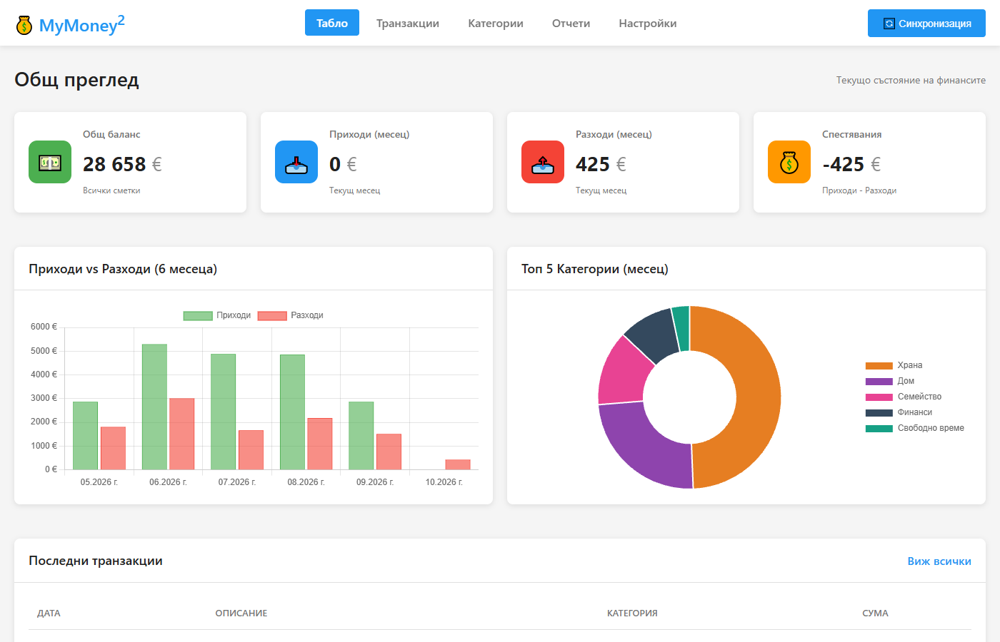
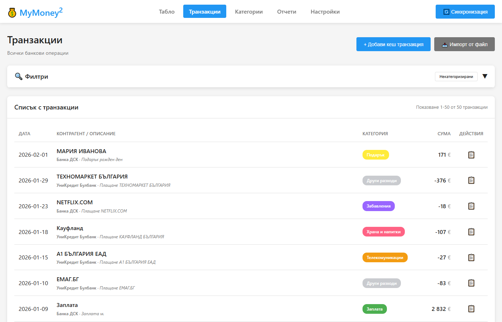
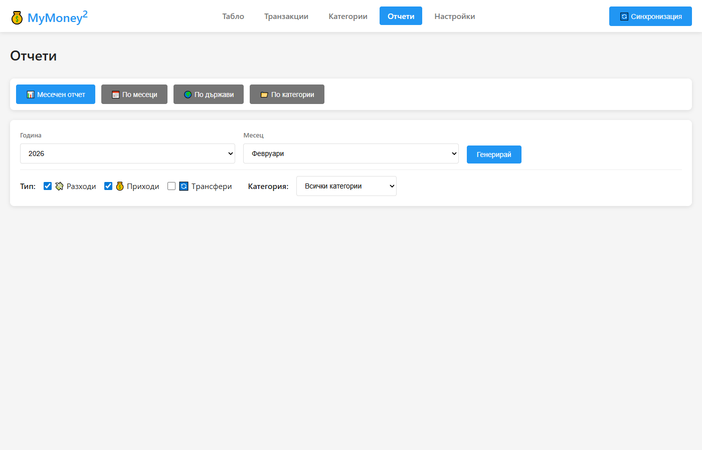
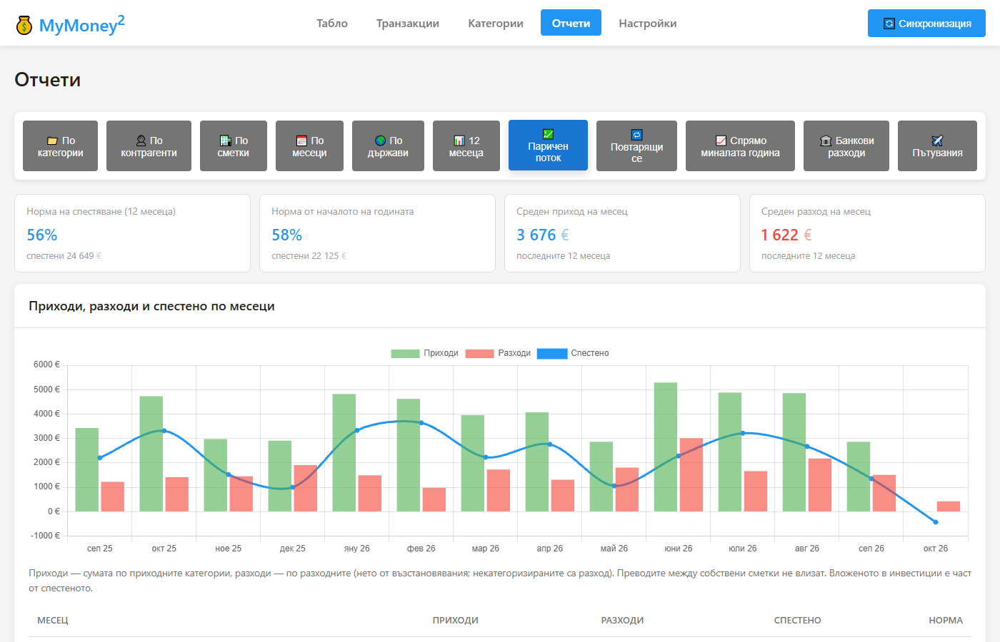
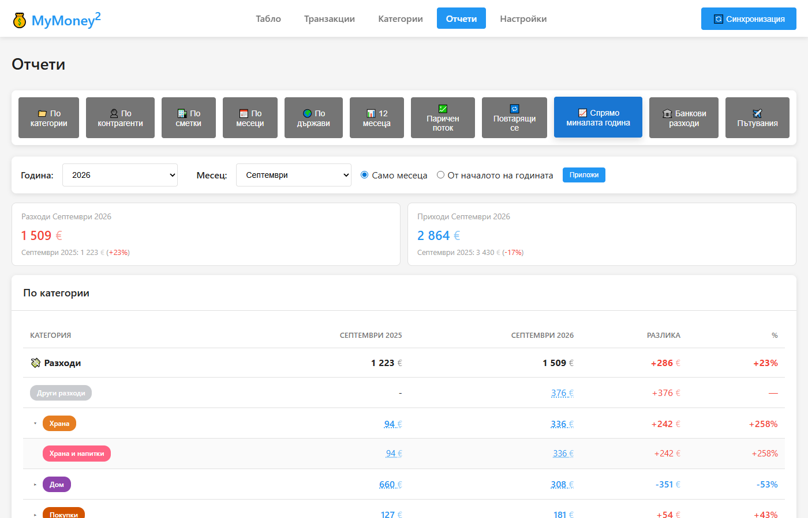
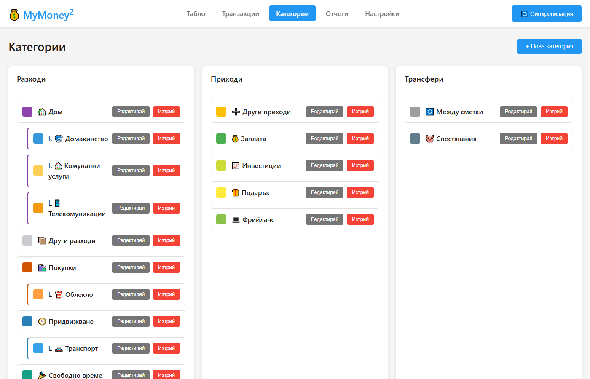

# MyMoney²

Приложение за лични финанси: изтегля автоматично транзакциите от банковите сметки, разпределя ги по категории и показва справки за приходите, разходите и спестяванията. Работи локално — на вашия компютър или на домашен сървър.

## Какво прави

- **Банкови сметки** — връзка с банката през GoCardless (PSD2, само четене): наличности и транзакции. Изпитано с Банка ДСК (разплащателни и кредитни карти) и Revolut (с джобовете и валутните сметки).
- **Импорт от файл** — за история, по-стара от това, което дава банката: ДСК „Excel“ (.xls) и Revolut CSV. Сметката се разпознава от файла, а транзакциите, които вече са дошли от банката, се пропускат. След всяка синхронизация записите от файл и от банката се обединяват автоматично.
- **Категории** — групи и подкатегории (напр. „Храна“ → „Храна и напитки“, „Кофис“, „Работа обяд“), правила по текст („KAUFLAND|LIDL“ → Храна и напитки) и подсказка по предишните плащания към същия контрагент.
- **Табло и справки** — по категории, контрагенти, сметки, месеци и държави; паричен поток и норма на спестяване; повтарящи се плащания (абонаменти); сравнение с миналата година; банкови такси; пътувания в чужбина.
- **Telegram** — съобщение за всяка нова транзакция с бутони за категория; отговор на съобщението става бележка.
- **Автоматизация** — синхронизация по график (до 4 пъти на ден), ежедневен архив на базата, напомняне преди изтичане на достъпа до банката.

Особеностите на банките (блокирани суми по карти при ДСК, вътрешни прехвърляния при Revolut, кредитни карти, които връщат наличния лимит вместо баланс) се обработват автоматично — подробности в [CLAUDE.md](CLAUDE.md).

## Снимки

| | |
|---|---|
|  |  |
| **Табло** — наличност, приходи и разходи, топ групи категории | **Транзакции** — филтри, търсене, категоризация |
|  |  |
| **Справка по категории** — групите се разгъват към подкатегориите | **Паричен поток** — приходи, разходи и спестено по месеци |
|  |  |
| **Спрямо миналата година** | **Категории и правила** |

Снимките са от демо данни (`npm run seed-demo`, после `node screenshots.js`).

## Изисквания

- **Node.js 20 или по-нов** — https://nodejs.org
- Windows, macOS или Linux (вкл. Raspberry Pi). `sqlite3` е нативен модул — ако за вашата платформа няма готов двоичен файл, `npm install` го компилира и тогава трябват `python3` и компилатор (Linux: `sudo apt install build-essential python3`; Windows: „Desktop development with C++“ от Visual Studio Build Tools).
- Акаунт в **GoCardless Bank Account Data** (Secret ID и Secret Key) за връзката с банката. Внимание: GoCardless ограничи регистрацията на нови клиенти за тази услуга — проверете дали все още може да се създаде акаунт. Без него приложението работи с импорт от файл.

## Инсталация

### На компютър (Windows / macOS / Linux)

```bash
git clone https://github.com/darcoto/mymoney2.git    # или изтеглете и разархивирайте
cd mymoney2
npm install
npm start
```

Отворете **http://localhost:3456**. Под Windows може да се ползва `start.bat` (стартира и отваря браузъра), под macOS/Linux — `start.sh`.

Настройки по желание: копирайте `.env.example` като `.env` — `PORT` (порт), `HOST` (адрес за слушане, по подразбиране `0.0.0.0`; `127.0.0.1` зад reverse proxy), `DATABASE_NAME` (файл на базата в `data/`). Промяната иска рестарт.

### Linux сървър (работи постоянно)

За домашен сървър или Raspberry Pi: приложението работи като systemd услуга, синхронизира по график, прави ежедневен архив и праща известия в Telegram. Отваря се от браузър в домашната мрежа (напр. `http://192.168.1.10:3456`).

```bash
# Node.js 20+ (напр. от NodeSource) и потребител за услугата
sudo useradd --system --home /opt/mymoney2 --shell /usr/sbin/nologin mymoney
sudo git clone https://github.com/darcoto/mymoney2.git /opt/mymoney2
cd /opt/mymoney2
sudo npm ci --omit=dev
sudo mkdir -p data && sudo chown -R mymoney:mymoney /opt/mymoney2/data

# Данните от стария компютър — виж „Пренасяне на данните“ по-долу

sudo cp deploy/mymoney2.service /etc/systemd/system/
sudo systemctl daemon-reload
sudo systemctl enable --now mymoney2
systemctl status mymoney2
journalctl -u mymoney2 -f        # логове (подробните са в data/app.log)
```

След това в **Настройки**:
- **Автоматизация** — включете „Синхронизация по график“ (по подразбиране 07:00, 12:00, 17:00, 22:00 — банката позволява около 4 заявки на ден за сметка) и проверете часа на ежедневния архив (03:00; пазят се 14 дневни и 12 месечни копия в `data/backups`).
- **Telegram** — създайте бот в @BotFather (`/newbot`), поставете token-а и натиснете „Свържи моя Telegram“.
- **Достъп** — задайте парола (ако базата е пренесена, паролата идва с нея).

Важно:
- **Парола и домашна мрежа.** Задайте парола (Настройки → Достъп). Връзката е HTTP — паролата минава некриптирана, затова не отваряйте приложението директно към интернет (без пренасочване на порт). За достъп отвън — VPN (WireGuard, Tailscale) или reverse proxy с HTTPS.
- **Часова зона.** Графикът е по българско време независимо от сървъра (`TZ_APP` за друга зона).
- **Една инстанция с график и Telegram.** Ако приложението работи и на друг компютър със същата база, изключете там синхронизацията по график и бота — иначе заявките към банката се удвояват, а Telegram не позволява две инстанции на един бот.
- **Обновяване:** `cd /opt/mymoney2 && sudo git pull && sudo npm ci --omit=dev && sudo systemctl restart mymoney2`. Схемата на базата се обновява сама при старт.

### Пренасяне на данните на друга машина

Всичко е в един файл — **`data/finance.db`**: сметките, транзакциите, категориите и правилата, ключовете за GoCardless, връзките с банките, token-ът на Telegram и настройките.

1. На старата машина спрете приложението или вземете последния архив (`data/backups/*.db`, или бутона за архив в Настройки).
2. Копирайте файла в `data/finance.db` на новата машина (на Linux сървъра: `sudo chown mymoney:mymoney /opt/mymoney2/data/finance.db`).
3. По желание: `data/backups/` (старите архиви) и `.env` (ако сте сменяли порта или базата).
4. Стартирайте. Връзките с банките продължават да работят — не е нужно ново одобрение.
5. Изключете графика и Telegram на старата машина (или я спрете).

`data/` и `.env` не са в git — съдържат лични данни и ключове.

## Първоначална настройка

1. **Настройки → GoCardless** — въведете Secret ID и Secret Key (от https://bankaccountdata.gocardless.com → User secrets).
2. **Добави банка** — изберете банката и одобрете достъпа в нея. След връщането синхронизацията тръгва сама. Достъпът важи 180 дни (ДСК, Revolut); после натиснете **„Поднови“** при връзката — историята се запазва.
3. **По-стара история** — Транзакции → импорт от файл (ДСК .xls, Revolut CSV).
4. **Парола** — Настройки → Достъп.
5. **Категории** — прегледайте групите и правилата. Некатегоризираните транзакции се виждат с филтъра „Без категория“ (и в Telegram с `/pending`).

## Сигурност и поверителност

- **Парола** — Настройки → Достъп (без потребители, само парола; сесията важи 30 дни, 5 грешни опита блокират входа за 15 минути). Паролата се пази като хеш в базата. Забравена парола — на сървъра: `node bin/set-password.js <нова>` (с `sudo -u mymoney` на Linux сървъра).
- Данните се пазят **локално**, в папка `data`. Към външни услуги отиват само заявките към банката (GoCardless) и — ако е включен — известията в Telegram (сума, контрагент, описание на новата транзакция).
- Ключовете за GoCardless и token-ът на Telegram са в базата — не споделяйте `data/` и архивите.
- Достъпът до банката е само за четене — приложението не може да прави плащания.
- Telegram ботът отговаря само на свързания чат.

## Често задавани въпроси

**Колко назад се изтеглят транзакциите?** Зависи от банката — ДСК дава 90 дни, Revolut до 2 години. По-старите се импортират от файл.

**Защо синхронизацията спря след няколко месеца?** Достъпът до банката е за ограничен период (обикновено 180 дни). Натиснете **„Поднови“** в Настройки и потвърдете в банката. Приложението предупреждава 7 дни по-рано.

**Защо е само 4 пъти на ден?** Банките (PSD2) позволяват около 4 автоматични заявки на ден за сметка; повече връщат грешка до следващия ден.

**Enable Banking?** Има начална интеграция, но не е завършена (виж [docs/ROADMAP.md](docs/ROADMAP.md)) — засега ползвайте GoCardless.

## Разработка

- [CLAUDE.md](CLAUDE.md) — архитектура, файлове, база данни, особености на банките, как се тества (на английски).
- [docs/ROADMAP.md](docs/ROADMAP.md) — какво прави приложението като поток от данни и идеите за развитие.
- Демо база: `npm run seed-demo`, после `npm run demo` (или `DATABASE_NAME=demo.db`).
