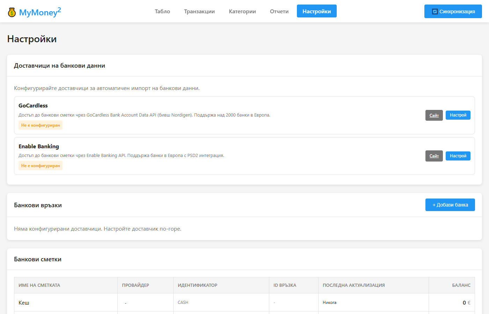

# MyMoney²

Приложение за управление на лични финанси с автоматична синхронизация на банкови сметки.

## Какво представлява MyMoney²?

MyMoney² е приложение, което ви помага да следите личните си финанси. То автоматично изтегля транзакциите от вашите банкови сметки и ви дава ясна картина за приходите и разходите ви.

### Основни възможности

- **Автоматична синхронизация** - Свързвате банковите си сметки и приложението автоматично изтегля всички транзакции
- **Табло (Dashboard)** - Виждате общия баланс, приходи и разходи в удобни графики
- **Категоризация** - Транзакциите се разпределят по категории (храна, транспорт, сметки и др.)
- **Автоматично разпознаване** - Приложението се учи кои плащания към кои категории спадат
- **Отчети** - Месечни и годишни справки за разходите ви по категории
- **Поверителност** - Всички данни се съхраняват локално на вашия компютър

## Screenshots

### Табло (Dashboard)
Началната страница с обобщена информация за финансите ви - баланс, приходи/разходи и графики.


### Транзакции
Списък с всички транзакции с филтри, търсене и категоризация.


### Категории
Управление на категории и правила за автоматична категоризация.


### Настройки
Свързване на банкови сметки чрез GoCardless.



## Какво е необходимо?

### Изисквания

- Компютър с Windows, Mac или Linux
- Node.js (безплатна програма, която можете да изтеглите от https://nodejs.org)
- Акаунт в GoCardless (безплатен за лична употреба)

### Поддържани банки

Приложението работи с банки, поддържани от GoCardless Bank Account Data API. Това включва повечето европейски банки, включително български банки като:
- УниКредит Булбанк
- ДСК Банк
- Пощенска банка
- Райфайзенбанк
- и други

## Инсталация

### Вариант 1: Глобална инсталация (препоръчително)

Инсталирайте като CLI команда с npm:

```bash
npm install -g mymoney2
```

След инсталация стартирайте с:

```bash
mymoney2
```

Или стартирайте директно без инсталация:

```bash
npx mymoney2
```

#### CLI опции

```
mymoney2 [options]

Options:
  -p, --port <number>  порт за сървъра (по подразбиране: 3456)
  --no-open            не отваряй браузъра автоматично
  -V, --version        показва версията
  -h, --help           показва помощ
```

Примери:

```bash
mymoney2 --port 4000       # Стартира на порт 4000
mymoney2 --no-open         # Стартира без отваряне на браузър
```

### Вариант 2: От изходния код

#### Стъпка 1: Изтегляне

Изтеглете приложението и го разархивирайте в папка по ваш избор.

#### Стъпка 2: Инсталиране на зависимости

Отворете Command Prompt (Windows) или Terminal (Mac/Linux), отидете в папката на приложението и изпълнете:

```
npm install
```

#### Стъпка 3: Стартиране

```
npm start
```

Приложението ще се стартира и ще бъде достъпно в браузъра на адрес: **http://localhost:3456**

### Вариант 3: Linux сървър (работи постоянно)

Подходящо за домашен сървър или Raspberry Pi: приложението работи като systemd услуга, синхронизира по график, прави ежедневен архив и праща известия в Telegram. Отваря се от браузър в домашната мрежа (напр. `http://192.168.1.10:3456`).

```bash
# Node.js 20+ (напр. от NodeSource) и потребител за услугата
sudo useradd --system --home /opt/mymoney2 --shell /usr/sbin/nologin mymoney
sudo git clone <адрес на хранилището> /opt/mymoney2      # или копирайте папката
cd /opt/mymoney2
sudo npm ci --omit=dev
sudo mkdir -p data && sudo chown -R mymoney:mymoney /opt/mymoney2/data

# Пренасяне на съществуващите данни (по желание): копирайте data/finance.db от стария компютър в /opt/mymoney2/data/

sudo cp deploy/mymoney2.service /etc/systemd/system/
sudo systemctl daemon-reload
sudo systemctl enable --now mymoney2
systemctl status mymoney2
```

След това в **Настройки**:
- **Автоматизация** — включете „Синхронизация по график“ (по подразбиране 07:00, 12:00, 17:00, 22:00 — банката позволява около 4 заявки на ден за сметка) и проверете часа на ежедневния архив (03:00; пазят се 14 дневни и 12 месечни копия в `data/backups`).
- **Telegram** — създайте бот в @BotFather (`/newbot`), поставете token-а и натиснете „Свържи моя Telegram“. За всяка нова транзакция идва съобщение с бутони за категория.

Важно:
- **Само в домашната мрежа.** Приложението няма вход с парола — не го отваряйте към интернет (без пренасочване на порт). Ако е нужен достъп отвън — VPN (напр. WireGuard/Tailscale) или reverse proxy с HTTPS и парола.
- **Часова зона.** Графикът е по българско време независимо от сървъра (`TZ_APP` за друга зона).
- **Само една инстанция с график и Telegram.** Ако приложението работи и на друг компютър със същите настройки, изключете там синхронизацията по график и бота — иначе заявките към банката се удвояват, а Telegram отказва две инстанции на един бот.
- **Обновяване:** `cd /opt/mymoney2 && sudo git pull && sudo npm ci --omit=dev && sudo systemctl restart mymoney2`.

## Конфигурация

### Получаване на GoCardless credentials

За да свържете банковите си сметки, трябва да получите безплатни API credentials от GoCardless:

1. Отидете на https://bankaccountdata.gocardless.com/
2. Създайте безплатен акаунт (натиснете "Sign up")
3. След регистрация, влезте в акаунта си
4. От менюто отляво изберете "User secrets"
5. Ще видите вашите **Secret ID** и **Secret Key**

### Настройване на приложението

1. Отворете приложението и отидете в **Настройки**
2. При доставчика GoCardless въведете вашите **Secret ID** и **Secret Key** и ги запазете

По желание: копирайте `.env.example` като `.env`, за да смените порта (`PORT`) или файла на базата данни (`DATABASE_NAME`).

## Използване

### Първоначална настройка

1. **Отворете приложението** в браузъра (http://localhost:3456)
2. **Отидете в Настройки** от менюто
3. **Свържете банка** - изберете вашата банка от списъка и следвайте инструкциите за оторизация
4. **Синхронизирайте** - натиснете бутоните за синхронизация на сметки и транзакции

### Ежедневно използване

#### Табло (Dashboard)
Началната страница показва обобщена информация:
- Общ баланс по всички сметки
- Графика на приходи и разходи
- Последните транзакции

#### Транзакции
- Преглед на всички транзакции от всички сметки
- Филтриране по дата, сметка, категория или тип
- Търсене по описание или контрагент
- Кликнете върху транзакция за детайли и задаване на категория

#### Категории
- Създаване на собствени категории за разходи и приходи
- Настройка на правила за автоматично категоризиране
- Пример: всички плащания към "Кауфланд" автоматично отиват в категория "Храна"

#### Отчети
- Месечни справки за разходите по категории
- Графики за визуализация на разходите
- Сравнение между периоди

### Съвети

- **Редовно синхронизирайте** - За актуална информация, синхронизирайте транзакциите поне веднъж седмично
- **Настройте правила** - Колкото повече правила за категоризиране добавите, толкова по-малко ръчна работа ще имате
- **Архив** - Ежедневният архив е включен по подразбиране (Настройки → Автоматизация); копията са в `data/backups`

## Сигурност и поверителност

- Всички данни се съхраняват **локално на вашия компютър**
- Никаква информация не се изпраща към външни сървъри (освен към GoCardless за синхронизация)
- Пазете вашите GoCardless credentials в тайна — те се съхраняват в базата данни в папка `data`
- Не споделяйте папката `data` с никого
- При включени известия в Telegram сумата, контрагентът и описанието на всяка нова транзакция минават през сървърите на Telegram. Ботът отговаря само на свързания чат

## Често задавани въпроси

**В: Безплатно ли е приложението?**
О: Да, приложението е напълно безплатно. GoCardless също предлага безплатен план за лична употреба.

**В: Безопасно ли е да свързвам банковата си сметка?**
О: GoCardless е лицензирана финансова институция в ЕС. Приложението има само достъп за четене на транзакции - не може да прави плащания или преводи.

**В: Колко назад във времето се изтеглят транзакциите?**
О: Зависи от банката — например ДСК дава 90 дни, а Revolut до 2 години. По-стари данни (или период, в който връзката с банката е била прекъсната) могат да се импортират от файл — ДСК Excel (.xls), Revolut CSV. Сметката се разпознава автоматично, а транзакциите, които вече са влезли от банката, се пропускат.

**В: Защо синхронизацията спря да работи след няколко месеца?**
О: Достъпът до банката е валиден ограничен период (обикновено 180 дни). След това в **Настройки** натиснете **„Поднови“** при връзката и потвърдете достъпа в банката. Сметките и историята на транзакциите се запазват.

**В: Какво става ако банката ми не се поддържа?**
О: Проверете списъка с поддържани институции в GoCardless. Повечето големи европейски банки са включени.

---

Създадено с любов за по-добро управление на личните финанси.
